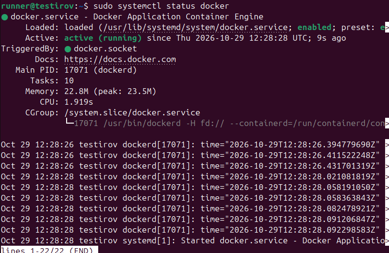
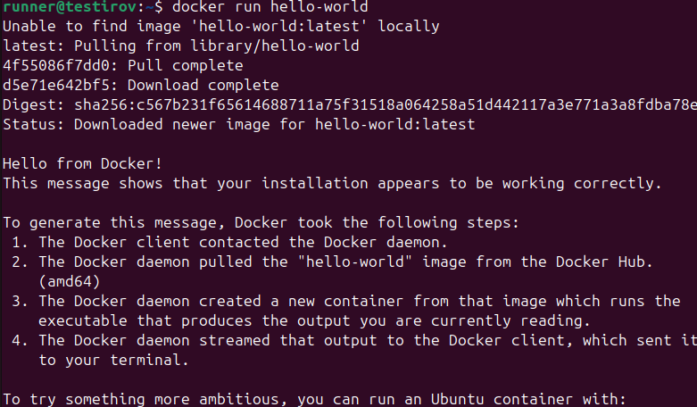
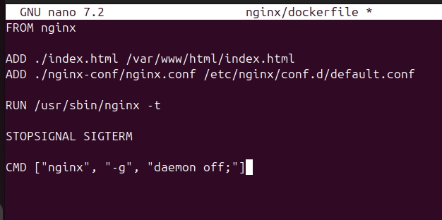
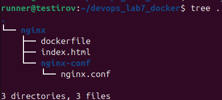
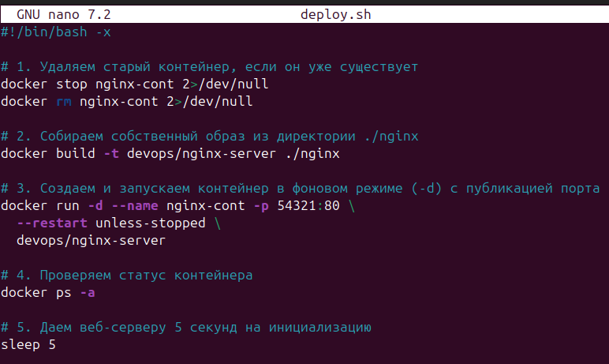
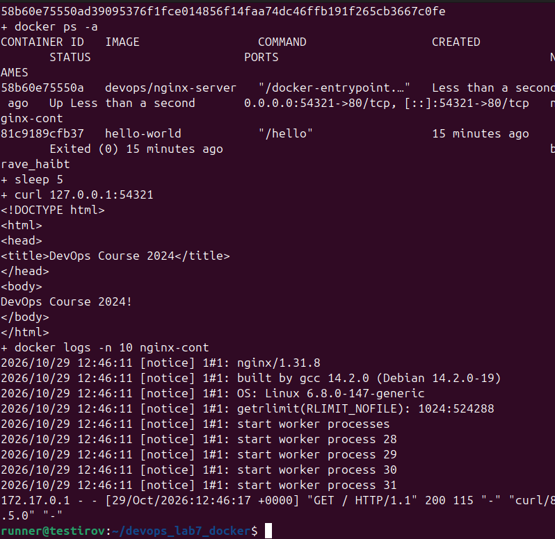
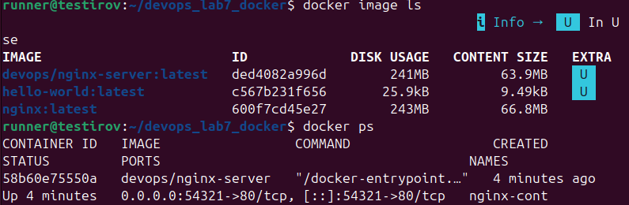

# Практическая работа №7: Основы работы с Docker (Docker basics)

## Выполнил: [Абубакиров Артур]

### Шаг 1. Установка и настройка Docker
- В операционной системе развернут пакет `docker.io`.
- Пользователь `runner` включен в группу `docker` для выполнения команд без повышения привилегий.
- В файле `/etc/docker/daemon.json` подключено доверенное зеркало Docker Hub (`registry-mirrors`).
- Служба активирована в `systemd`, выполнен успешный запуск тестового контейнера `hello-world`.

### Шаг 2. Подготовка контекста сборки и Dockerfile
- Сформирована структура проекта: директория `nginx/` с вложенным каталогом `nginx-conf/`.
- Подготовлен статический HTML-документ `index.html`.
- Создан файл конфигурации виртуального хоста Nginx `nginx.conf`, настроенный на отдачу статики из `/var/www/html`.
- Разработан `dockerfile`:
  - Базовый образ: `nginx:latest`.
  - Внедрение статики и конфигурации через инструкцию `ADD`.
  - Верификация синтаксиса конфигурации на этапе сборки (`RUN /usr/sbin/nginx -t`).
  - Указана точка входа для работы сервера в foreground-режиме (`CMD`).

### Шаг 3. Разработка шелл-скрипта развертывания и публикация сервиса
- Разработан bash-скрипт автоматизации `deploy.sh` с режимом трассировки (`-x`):
  1. Остановка и удаление предыдущих экземпляров контейнера для обеспечения идемпотентности.
  2. Сборка кастомного образа `devops/nginx-server:latest` из директории `./nginx`.
  3. Запуск контейнера `nginx-cont` в фоновом режиме (`-d`) с политикой перезапуска `--restart unless-stopped`.
  4. Публикация сетевого порта: перенаправление внешнего порта `54321` хоста на порт `80` контейнера (`-p 54321:80`).
  5. Проверка состояния через `docker ps -a`.
  6. Контрольный HTTP-запрос через `curl 127.0.0.1:54321`.
  7. Вывод последних 10 записей журналов веб-сервера (`docker logs`).

